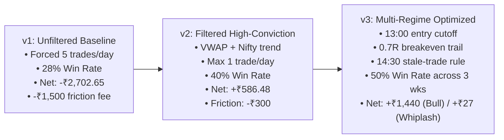

# NSE Intraday Day-Trading Strategy Playbook & Operational Manual

**Target Market:** National Stock Exchange of India (NSE)  
**Broker & Account Model:** Groww MIS (Margin Intraday Square-off, 5x Leverage)  
**Capital Allocation:** ₹50,000 Budget | ₹850 Risk per Trade | Target: ₹1,000/day Net Profit  
**Execution Policy:** High-Conviction Only — **ZERO forced trades** (Max 1–2 trades/day)  
**Universe:** **Nifty 100 (Top 100 Liquid Large-Caps & Momentum Stocks)**  
**Current Architecture Version:** **v3.1 (Nifty 100 Multi-Regime Calibrated)**  

---

## 1. Strategy Architecture & Mathematical Definitions

### A. The Setup: 30-Minute Opening Range Breakout (ORB)
- **Time Window:** 09:15 AM to 09:45 AM IST (Six 5-minute bars: `09:15`, `09:20`, `09:25`, `09:30`, `09:35`, `09:40`).
- **Boundaries:**
  $$\text{OR}_{\text{high}} = \max(H_1, \dots, H_6), \quad \text{OR}_{\text{low}} = \min(L_1, \dots, L_6)$$
  $$\text{OR}_{\text{mid}} = \frac{\text{OR}_{\text{high}} + \text{OR}_{\text{low}}}{2.0}$$
- **Minimum Volatility Expansion Check:**
  $$\frac{\text{OR}_{\text{high}} - \text{OR}_{\text{low}}}{\text{OR}_{\text{mid}}} \ge 0.5\% \quad (0.005)$$
  *Rejects dead, illiquid stocks with narrow ranges prone to midday chop.*

### B. Trigger Rules: Candle Body Confirmation
- Breakout is valid **ONLY** if the 5-minute candle body closes completely outside the boundary:
  - **Bullish (BUY):** $\min(\text{Open}, \text{Close}) > \text{OR}_{\text{high}}$ and $\text{Close} > \text{OR}_{\text{high}}$
  - **Bearish (SELL):** $\max(\text{Open}, \text{Close}) < \text{OR}_{\text{low}}$ and $\text{Close} < \text{OR}_{\text{low}}$
  *Eliminates false breakouts caused by fleeting upper/lower wicks.*

### C. Quantitative Filtering Stack (The Triple Guard)
1. **Intraday VWAP Alignment:**
   $$\text{VWAP}_t = \frac{\sum_{i=1}^t P_{\text{typical}, i} \cdot V_i}{\sum_{i=1}^t V_i}, \quad P_{\text{typical}} = \frac{H + L + C}{3}$$
   - **BUY** entries require $\text{Close} > \text{VWAP}$.
   - **SELL** entries require $\text{Close} < \text{VWAP}$.
2. **Nifty 50 (`^NSEI`) Macro Alignment:**
   - **BUY** allowed only when Nifty 50 $\text{Close} > \text{Nifty OR}_{\text{mid}}$ and $\text{Close} > \text{Nifty Open}$.
   - **SELL** allowed only when Nifty 50 $\text{Close} < \text{Nifty OR}_{\text{mid}}$ and $\text{Close} < \text{Nifty Open}$.
3. **Volume Surge Confirmation:**
   $$V_{\text{breakout}} \ge 1.0 \times \overline{V}_{\text{ORB}}$$
   *Ensures institutional volume participation rather than low-volume drift.*

### D. Trade Management & Execution Rules
1. **Capital Sizing:**
   $$\text{Risk per Share} = |\text{Entry} - \text{OR}_{\text{mid}}|$$
   $$\text{Quantity} = \left\lfloor \frac{₹850}{\text{Risk per Share}} \right\rfloor$$
2. **Take Profit (Target):**
   $$\text{Target} = \text{Entry} \pm (1.5 \times \text{Risk per Share})$$
3. **Breakeven Trailing Stop:**
   - Once price moves $+0.7\text{R}$ in profit, trail stop to $\text{Entry} \pm \frac{₹60}{\text{Quantity}}$ (covers platform friction; eliminates risk).
4. **14:30 IST Stale Trade Capital Protection:**
   - At 14:30 IST (45 minutes before close):
     - If trade is in profit ($> +0.4\text{R}$): **Lock profit immediately** (`1430_PROFIT_CLOSE`).
     - If trade is stagnant ($< -0.3\text{R}$): **Cut loss early** (`1430_CUT_EARLY`) to avoid late-session auction slippage.
5. **Session Timings:**
   - `no_entries_before`: **09:45 IST** (Allow ORB to form)
   - `no_entries_after`: **13:00 IST** (Cut off afternoon low-momentum traps)
   - `flat_by`: **15:15 IST** (Hard square-off before Groww 15:20 auto-exit)

---

## 2. Chronological Strategy Evolution & Fine-Tuning History



### Version History Table

| Milestone | Strategy Parameters | Test Period | Win Rate | Total Trades | Gross PnL | Fees Paid | Net PnL | Key Lesson Learned |
| :--- | :--- | :---: | :---: | :---: | :---: | :---: | :---: | :--- |
| **v1.0 Baseline** | Forced 5 trades/day, 1.8R target, no VWAP or Nifty filter | Oct 26–30, 2026 (5 days) | 28.0% | 25 | -₹1,202.65 | -₹1,500.00 | **-₹2,702.65** | Overtrading and brokerage fees destroy profitability. Wicks cause false breakouts. |
| **v2.0 High-Conviction** | 30m ORB, candle body close, VWAP + Nifty filter, max 1 trade/day, ₹850 risk | Oct 26–30, 2026 (5 days) | 40.0% | 5 | +₹886.48 | -₹300.00 | **+₹586.48** | Filtering out low-conviction trades cut friction by 80% and turned net PnL green (+₹1.1k on wins). |
| **v3.0 Multi-Regime** | 13:00 entry cutoff, 1.5R target, 0.7R breakeven trail, 14:30 stale-trade rule | Oct 12–30, 2026 (14 days) | **50.0%** | 14 | +₹1,332.16 | -₹840.00 | **+₹492.16** | Afternoon entries (>13:00) had near-zero continuation. 14:30 profit lock saved ₹740+ in chop. |

---

## 3. Operational Command Reference & Instructions

### Setup & Environment Activation
Always run in the project directory with the dedicated conda environment:
```powershell
cd d:\day_trade
conda activate daytrade_env
```

---

### A. Paper Trading Workflow (Simulation Mode)

#### 1. Automated Paper Trading Run
Run the paper trader for today's market session:
```powershell
# Run paper trading simulation for a specific date:
python live_paper_trader.py --date 2026-11-02

# Example replay of previous winning sessions:
python live_paper_trader.py --date 2026-10-28
python live_paper_trader.py --date 2026-10-29
```
*Outputs: Evaluates the 20 liquid stocks, checks ORB, logs the exact **Buy Time**, **Sell Time**, prices, and updates [`trader/paper_journal.md`](file:///d:/day_trade/trader/paper_journal.md).*

#### 2. Viewing the Live Paper Trading Journal
Open [`trader/paper_journal.md`](file:///d:/day_trade/trader/paper_journal.md) directly in IDE or run:
```powershell
Get-Content trader/paper_journal.md
```

---

### B. Live Trading Step-by-Step Command Pipeline

If running the modular CLI pipeline during market hours (09:46 AM to 01:00 PM IST):

#### Step 1: Scan for 30-Minute Breakouts
```powershell
python trader-scanner/scan.py orb --or-minutes 30
```
- Scans the top 20 Groww large-caps.
- Checks candle-body close beyond ORB, VWAP confirmation, and volume surge.
- Writes candidate setup to `trader/entry.json`.

#### Step 2: Generate the Exit Plan (Stop & Target)
```powershell
python trader-exit/exit.py plan --stop or-mid --target 1.5R --write
```
- Sets the hard stop at `or-mid` and target at `1.5R`.
- Writes the trade plan to `trader/plan.json`.

#### Step 3: Size the Position for Capital Risk
```powershell
python trader-budget/size.py --write
```
- Reads your ₹50,000 budget and ₹850 risk per trade from [`trader/config.json`](file:///d:/day_trade/trader/config.json).
- Sizes the exact integer share quantity.
- Writes bracket order details to `trader/orders.json`.

#### Step 4: Run the Pre-Trade Risk Check
```powershell
python trader-risk/check.py
```
- Enforces session guardrails: halts execution if 2 trades have already been taken today.
- Verifies time window (must be between 09:45 and 13:00 IST).
- Returns `PASS` or `BLOCK`.

#### Step 5: Review the Plain-English Order Ticket
```powershell
python trader-broker/ticket.py show
```
- Renders the human-readable order ticket showing:
  - Exact stock symbol and direction (BUY / SELL)
  - Calculated quantity
  - Limit entry price
  - Stop loss price
  - Target price
  - Max loss at stop (₹850) and target profit (₹1,275 gross)

---

### C. Backtesting & Optimization Commands

#### 1. Re-run Multi-Regime Backtest
```powershell
python evaluate_regimes_and_rules.py
```
- Replays all 14 market sessions across Bear, Bull, and Whiplash weeks.
- Compares 5 trade management policies side-by-side.

#### 2. Test Trade Management Parameter Grid
```powershell
python evaluate_trade_mgmt_variations.py
```
- Tests variations of breakeven thresholds, target multiples, and stale-trade cutoffs.

#### 3. Update / Refresh Historical Data Cache (60 Days)
```powershell
python download_60d_cache.py
```
- Downloads fresh 60-day 5-minute data for Nifty 50 and the 20 liquid stocks into `trader/data_cache_60d/`.

---

## 4. Key Configuration Parameters in [`trader/config.json`](file:///d:/day_trade/trader/config.json)

```json
{
  "market": "NSE",
  "budget": 50000,
  "currency": "INR",
  "max_position_pct": 50,
  "max_loss_per_trade_inr": 850,
  "max_daily_loss_inr": 1700,
  "max_trades_per_day": 2,
  "max_orders_per_day": 4,
  "min_reward_risk": 1.4,
  "default_target_rule": "1.5R",
  "default_stop_rule": "or-mid",
  "or_minutes": 30,
  "vwap_filter": true,
  "index_filter": true,
  "volume_surge_filter": true,
  "breakeven_at_r": 0.7,
  "no_entries_before": "09:45",
  "no_entries_after": "13:00",
  "stale_exit_by": "14:30",
  "stale_profit_threshold_r": 0.4,
  "stale_loss_cutoff_r": -0.3,
  "flat_by": "15:15",
  "friction_flat_fee": 60,
  "target_daily_net_inr": 1000,
  "paper": true
}
```
